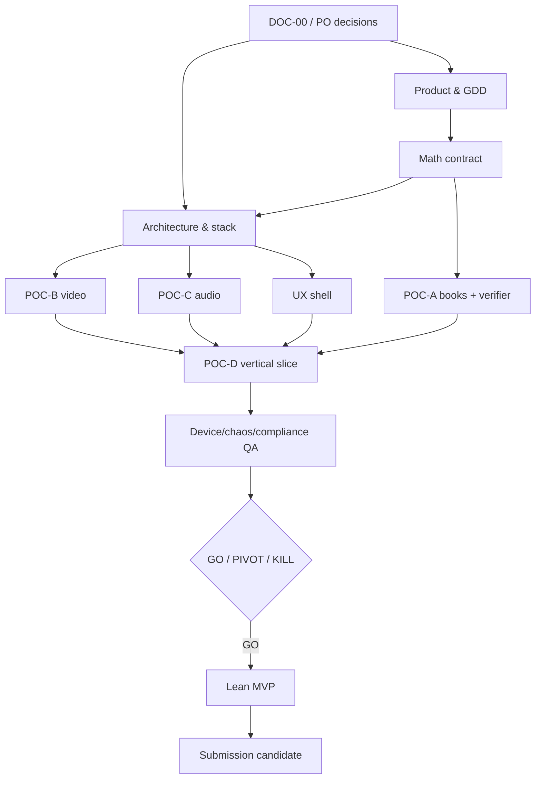

# Dependency Map

Version 0.9.0 · 2026-10-18 · Status: proposed.

## Blocking rules

- Architecture approval blocks all gameplay code.
- G2 spend/license approval blocks paid generation and external storage purchase.
- Event schema blocks frontend/math integration; changes require both owners.
- Canonical character approval blocks video variants.
- Audio stem technical acceptance blocks runtime mix acceptance.
- Independent math verification blocks candidate integration and submission.
- POC-A/B/C + responsive shell block POC-D.
- Real-device/replay/compliance QA blocks GO.

Non-blocking preparation: reviewers may author test criteria and static fixtures; UX may draft wireframes; agents may compare terms without purchase.
