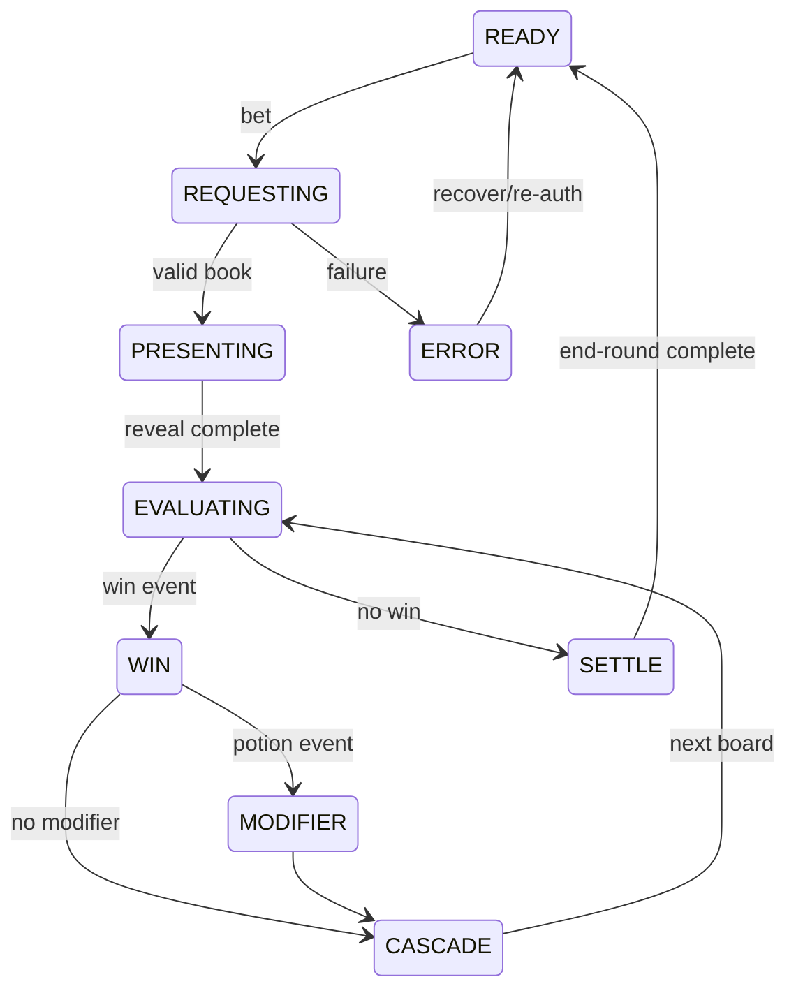

# Game Design Document

## Decision labels

`FIXED` — supplied concept/platform constraint. `PROPOSED` — recommendation awaiting PO. `MATH TBD` — cannot be promised until simulation. Numbers below are not a paytable approval.

## Rules

- `FIXED` board is 6 columns × 5 rows; 30 visible symbol positions.
- `PROPOSED` pay-anywhere wins for ≥8 matching regular symbols anywhere on the board. Only the largest threshold for a symbol pays per cascade.
- All simultaneous symbol wins pay before removal; winning positions are the union of paid groups. `MATH TBD`: whether potion occupies/replaces a regular symbol or is overlay metadata.
- Paid symbols disappear, remaining symbols fall down per column, new symbols enter, and evaluation repeats until no win.
- `PROPOSED` Potion contributes an integer multiplier increment revealed by outcome events. Cauldron starts at ×1, accumulates only within the current bet (or within a self-contained bonus book), multiplies qualifying cascade wins, then resets.
- Total payout is the value supplied by the RGS book. UI-derived arithmetic is diagnostic only and must never settle a win.
- Win cap immediately stops further math events and proceeds to the documented cap presentation.

## Symbols (proposal)

| Class | Symbols | Function |
|---|---|---|
| High | Moon Goblet, Raven Mask, Thorn Rose, Crystal Eye | pay-anywhere |
| Low | Rune Vials A–E | pay-anywhere |
| Modifier | Potion | adds disclosed cauldron increment; exact weights TBD |
| Scatter | Coven Seal | full-version Free Spins trigger only; excluded pilot |

Pay thresholds proposed: 8 / 10 / 12 / 15 / 20+. Exact payouts, symbol weights and modifier values belong exclusively to DOC-03 candidate models.

## Round state machine

Input is locked from `REQUESTING` through `SETTLE`. Fast play changes cue durations and skips decoration, never event order or displayed final values.

## Reaction mapping — continuous loops

Every dance tier, including a Small Win, is a complete multi-second loop rather than an instantaneous pose or a one-shot. Direct transitions between any tiers use one common neutral anchor pose and occur only at a seam. A Potion triggers a short separate FX accent instead of a BONUS character state.

| Pilot event/tier | Temporary prototype threshold | Character behavior | Audio concept |
|---|---|---|---|
| IDLE | no active win tier | 4.2s continuous subtle sway loop | BASE |
| SMALL_WIN | paid event <4× bet | 3.6s light dance loop | small sting |
| MEDIUM_WIN | paid event ≥4× and <10× bet | 4.2s more active dance loop | ENERGY |
| BIG_WIN | paid event ≥10× bet | 4.8s climax dance loop | HOT + sting |
| BONUS | real `bonusStart` event (not in pilot) | 4.8s distinctive bonus dance loop | BONUS phase |
| POTION ACCENT | `multiplier` event | FX overlay without switching current loop | short cauldron cue |

Those thresholds are **prototype-only**, not approved production math or volatility. A win sequence requests the strongest tier, while board reveals and cascades never reset the dancer. The animation controller does not block a Spin settling; a queued winning dance finishes at least one full loop before returning to IDLE. See DOC-08 and DOC-10 for stitching, priority and interruption rules.

## UI behavior

Required: balance, selected bet, spin, exact win, cauldron multiplier, settings/mute, info/rules/paytable; all RGS bet levels; keyboard Space mapped to bet; autoplay only with explicit confirmation if retained; replay hides betting/session controls. Currency is integer API units at six-decimal precision and formatting is locale-aware.

## Edge cases

- network error before outcome: no animation and no balance assumption;
- interruption after outcome: authenticate/resume according to SDK lifecycle; never request a replacement outcome;
- malformed/unknown event: stop presentation, record safe diagnostic, show recoverable error;
- max win: ignore decorative continuation not present in book, show cap truthfully;
- tab background/audio suspension: resume timeline from event boundary; final state must converge;
- asset decode failure: static witch + silent/degraded layer, gameplay continues;
- reduced motion: dissolve/highlight instead of dance/particles;
- replay: same events, no wallet/session calls, Play/Play Again and final result retained.

## Acceptance criteria

Given any valid fixture, normal, fast and replay modes reach identical board, multiplier and final payout. Every win position is legible before removal. Cauldron resets across independent bets. Presentation engines cannot write domain state. Loss has no win-tier celebration. Invalid books fail closed with no new bet. Rules expose RTP, max win, costs and all modifier values after math approval.
