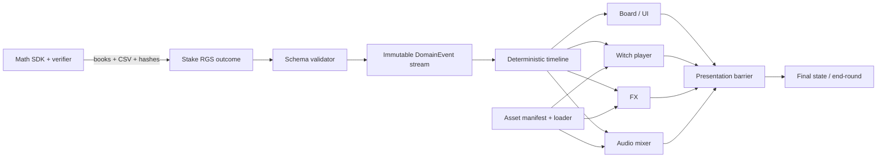

# Technical Architecture & Technology Stack

## Architecture



`DomainState` is immutable, math-owned and replayable. `PresentationState` contains current clip, audio gains, particle count and durations; it may be skipped/rebuilt and never changes payout.

## Current prototype versus target stack

| Block | Primary | Reserve | Reason |
|---|---|---|---|
| Frontend | current: browser ES modules, DOM/CSS, zero dependencies; target: official Web SDK pinned SHA with Svelte 5/PixiJS 8 | PixiJS 8 + TypeScript/Vite without Svelte | dependency-free proof now; closest official RGS/replay path next |
| Math | current: dependency-free Python deterministic core and verifier; target: official Math SDK pinned SHA, Python 3.12 | compatible custom generator only if an evidenced SDK blocker persists | mechanic proof now; required publish ecosystem next |
| Audio | Web Audio + SDK sound utilities | Howler wrapper | sample-accurate layered scheduling |
| Video | native `<video>` double-buffer: WebM VP9 + MP4 H.264; fixed background plate | WebP/AVIF spritesheet/frame sequence | broad decode with graceful fallback |
| FX | PixiJS particles/shaders | baked FX in video | consistent canvas timeline |
| Tests | Vitest/component tests, Storybook, Playwright; pytest math | browser/device manual lab | official SDK tooling plus automation |
| Media prep | FFmpeg/ffprobe pinned container | Shaka Packager only if later needed | deterministic transcode/probe |
| CI | GitHub Actions with pinned actions and lockfiles | local reproducible runner | PR gates and audit trail |

Official Web SDK repository currently documents Node 22.16 and pnpm 10.5; its sample package pins Svelte 5.20.5 and Vite 6.2.0. These are upstream observations, not permission to float versions: pilot records exact SHAs and lockfiles.

## Repository layout

```text
apps/web/{src,tests,scripts}
src/{future official Web SDK adaptation}
math/{game,config,verification,manifests}
tests/{fixtures,unit,integration,e2e,performance,math}
assets/{manifests,licenses,prompts,proxies}
tools/{media,schemas,quality}
agents/{roles,templates,handoffs}
```

## Contracts

```ts
type DomainEvent =
  | { index:number; type:'boardReveal'; board:SymbolId[][] }
  | { index:number; type:'win'; cascade:number; amount:number; positions:number[] }
  | { index:number; type:'multiplier'; from:number; increment:number; to:number }
  | { index:number; type:'cascade'; cascade:number; board:SymbolId[][] }
  | { index:number; type:'finalWin'; amount:number };

interface CuePlan { eventIndex:number; required:Cue[]; decorative:Cue[]; barrier:'all'|'required'; }
interface PlaybackPolicy { speed:'normal'|'fast'|'replay'; reducedMotion:boolean; muted:boolean; }
```

Validator checks exact board dimensions, monotonic event indices, integer amounts, legal positions, multiplier continuity and one terminal final event. Unknown types are not ignored silently.

## Runtime rules

- Event handler returns a `CuePlan`; timeline awaits required cues, caps decorative cues by deadline, then advances.
- Fast mode uses same plan with shorter duration tokens and removes optional cues.
- Replay starts from clean state and runs the identical domain stream with no session calls.
- Asset loader uses manifest hash, capability probe and priority tiers: shell/board → current witch idle → audio base → reaction clips → optional FX.
- Video/audio failure resolves the cue barrier through fallback; payout presentation can never deadlock on media.

## Build/deployment

PR: validate schemas/docs, lint/typecheck/unit, math fixtures, Storybook smoke, Playwright desktop/mobile, bundle/asset budget and secret scan. `main`: reproducible static build + checksums, no automatic external publish. Release candidate: manual approval creates signed/tagged artifact; ACP upload remains a human G5 step.

## Architecture acceptance

A reviewer can trace every displayed number to a domain event; playback policy cannot modify events; fixtures converge in normal/fast/replay; unsupported media falls back; version manifests pin SDK/toolchain/assets; no runtime service other than approved RGS/CDN is required.

For Gate 1 the first three conditions are automated in the local prototype. SDK/RGS replacement, media fallback and production version manifests remain next-slice work.
